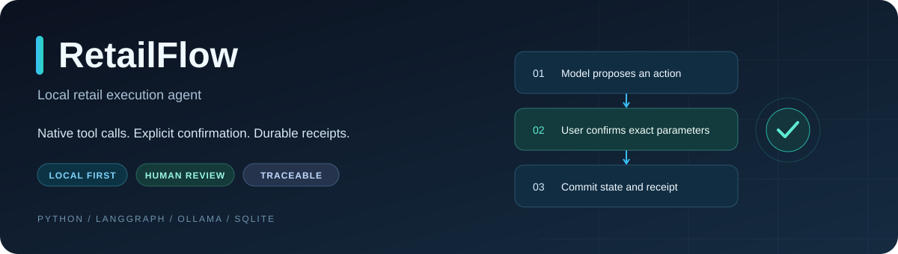
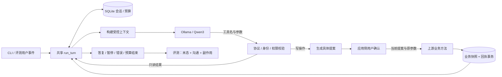

<p align="center">
  
</p>

<p align="center">
  <strong>让模型选择工具，让应用控制订单变化，让每一步都有据可查。</strong>
</p>

<p align="center">
  <a href="#quickstart"></a>
  <a href="#architecture"></a>
  <a href="#configuration"></a>
  <a href="#verification"></a>
  <a href="#limitations"></a>
</p>

<p align="center">
  <a href="#quickstart">快速开始</a> ·
  <a href="#demo">业务演示</a> ·
  <a href="#architecture">架构与机制</a> ·
  <a href="#evaluation">评测结果</a> ·
  <a href="#documentation">文档索引</a>
</p>

RetailFlow 是一个本地运行的多轮零售业务执行 Agent。它基于 [LangChain react-agent 模板](https://github.com/langchain-ai/react-agent)和 [τ2-bench retail 模拟环境](https://github.com/sierra-research/tau2-bench)进行二次开发，通过 Ollama 接入本地 Qwen3 模型，支持订单查询、取消和退货等有限场景。

项目关注的是业务执行边界：模型可以提出操作，但不能替用户确认；写入必须绑定具体提案与参数；进程恢复时应能判断操作是否已经提交；评测需要检查最终业务状态，而不是只看回复是否流畅。

> [!IMPORTANT]
> 当前仍是实验原型。现有 4B 的最新修复版 V5 完整 Dev 为 **1/9**，V4 为 **2/9**，效果尚不稳定。修复前的固定三组 Dev 均 **0/9**、Test 均 **0/4**，原始记录保留。129 个工程测试和单例演示不代表业务任务成功率。详见[评测结果](#evaluation)和[修复报告](reports/repair-native-dialogue.md)。

<a id="features"></a>
## 能做什么

| 能力 | 当前实现 |
| --- | --- |
| 本地工具调用 | `ChatOllama.bind_tools` 绑定原生工具 schema，LangGraph 执行模型—工具循环 |
| 订单业务 | 定位用户、查询资料/订单/商品、取消 pending 订单、申请 delivered 商品退货 |
| 显式确认 | 写工具先产生提案，应用展示参数；用户确认当前 `proposal_id` 后才能提交 |
| 参数变更保护 | 更换目标、商品或原因后，旧确认失效，新操作需要新提案 |
| 会话持久化 | SQLite 保存独立业务快照、完整消息、待确认操作、预算与执行回执 |
| 重复执行保护 | 已提交操作按回执恢复，避免本地重放再次增加退款或退货记录 |
| 上下文管理 | 关键状态与近期完整消息块；工具调用及对应返回成组保留 |
| 有限恢复 | 明确发生在执行前的只读临时故障最多重试一次，记录失败与重试成本 |
| 可复查评测 | 固定任务、角色隔离、独立初始状态、三组对照、末态与沟通分别检查 |

所有订单、用户和付款信息均来自固定模拟环境；项目不连接真实电商、支付或客服系统。当前入口为 CLI，没有网页、多 Agent、MCP 或训练流程。

<a id="quickstart"></a>
## 快速开始

### 1. 环境要求

| 组件 | 已验证参考环境 | 说明 |
| --- | --- | --- |
| 系统 / 硬件 | MacBook Air · Apple M5 · 16 GB 统一内存 | 实测机器，不是最低配置承诺；其他平台未做同等验收 |
| Python | 3.12.15 | 项目声明 `>=3.12,<3.14`，复现优先使用 3.12 |
| 包管理 | uv + `uv.lock` | 安装到项目独立 `.venv` |
| 本地推理 | Ollama 0.15.6 | 默认 `http://127.0.0.1:11434` |
| 模型 | `qwen3:4b-instruct-2507-q4_K_M` | 已缓存 Q4_K_M 文件约 2.50 GB；不会由项目自动下载 |

参考环境详情见 [machine.json](reports/evidence/t8/machine.json)。模型文件大小、Ollama loaded-model 指标与进程 RSS 不是同一种内存统计，不能相加后当作峰值占用。

### 2. 获取项目与安装依赖

```bash
git clone https://github.com/snowstorm-121/RetailFlow.git
cd RetailFlow
uv sync --locked --python 3.12
```

`uv sync` 是显式安装步骤，可能联网下载解释器或 Python 依赖；已有环境可直接使用后面的 `.venv/bin/python` 命令。项目不要求 PyTorch、Docker 或云模型 API Key，也不应在其他项目的环境中安装这些依赖。

### 3. 检查已有 Ollama 服务和模型

```bash
ollama list
curl -sS http://127.0.0.1:11434/api/version
```

确认模型列表包含完整标签 `qwen3:4b-instruct-2507-q4_K_M`。若服务或模型不存在，先单独准备本地环境；不要把其他模型静默替换成这个标签，也不要在共享机器上随意重启 Ollama。演示与评测不会自动拉取模型。

### 4. 校验数据，运行首次查询

```bash
.venv/bin/python -m retailflow.cli validate --manifest data/manifests/dataset.json
.venv/bin/python -m retailflow.cli chat \
  --thread "query-$(date +%Y%m%d-%H%M%S)" \
  --config configs/local.json \
  --message 'I am Yara Muller, ZIP 85041. What is the status of order #W5056519?'
```

校验结果应为 Dev 9 / Test 4 / Total 13，`valid: true`。这个查询提供了完整身份信息，适合先检查本地模型和工具链；缺信息开场的交互可靠性仍是已知问题。业务数据与工具描述为英文，演示请求也使用英文。

交互模式省略 `--message`，输入 `/quit` 退出。每次独立演示使用新的 `--thread`；相同 ID 会恢复原会话，不会重置订单。

<a id="demo"></a>
## 从一次取消订单看执行过程

### 真实模型：查询 → 提案 → 确认 → 提交

```bash
DEMO_THREAD="cancel-$(date +%Y%m%d-%H%M%S)"
.venv/bin/python -m retailflow.cli chat \
  --thread "$DEMO_THREAD" \
  --config configs/local.json \
  --message 'I am Yara Muller, ZIP 85041. Please cancel order #W5056519 because I ordered it by mistake.'
```

模型需要定位用户、读取订单并请求取消。写工具第一次只预检政策并生成提案，CLI 将显示类似内容：

```text
[needs_confirmation] Confirm cancel_pending_order with
{"order_id": "#W5056519", "reason": "ordered by mistake"}?
Confirm this exact action? Type yes or no:
```

核对订单号和原因后输入 `yes`；不匹配则输入 `no`。不能因为模型说了“已创建提案”就认定提案确实存在，也不能因为最终文本说“取消成功”就跳过状态核验。

<details>
<summary><strong>实际演示记录与跨进程恢复</strong></summary>

2026-10-20 的真实本地运行中，首个 CLI 在待确认处以 EOF 退出；第二个进程使用相同 thread 恢复提案，核对并确认后，订单由 pending 变为 cancelled，支付历史由 1 条变为 2 条，完整末态检查通过。最终答复说明信用卡退款需 5–7 个工作日，没有称已到账。

在提案提示处按 Ctrl-D 退出后，可在同一终端用以下命令恢复：

```bash
.venv/bin/python -m retailflow.cli chat \
  --thread "$DEMO_THREAD" --config configs/local.json
```

恢复时不要传新 `--message`：普通新消息会撤销尚未提交的提案。会话和提案预算均为 15 分钟量级，过期需新会话。

证据：[提案与确认轨迹映射](reports/evidence/t8/trace-index.json) · [取消末态检查](reports/evidence/t8/cancel-check.json)。

</details>

### 另外两条可复查路径

| 路径 | 执行方式 | 验证内容 |
| --- | --- | --- |
| 取消原因变更 | `.venv/bin/python examples/confirmation_change.py` | 直接调用真实业务保护层，不调用模型；旧提案确认被拒绝，新确认后才提交，重放不增加支付记录 |
| 已送达订单取消 | 真实模型定位并查询 `#W2378156` | 解释 delivered 不能取消，无写工具请求、无提案、业务快照不变；输出状态为 `answered` |

完整命令与失败定位见 [三条演示操作单](docs/demos.md)。直接保护层演示不是模型自主决策，也不是新增评测题。

<a id="architecture"></a>
## 架构与数据流



CLI 与评测都调用 `RetailRuntime.run_turn`；模型决定下一步工具，不按参考答案硬编码业务调用序列。用户脚本和评分器不参与模型规划。

### 工具与权限

| 工具 | 用途 | 关键边界 |
| --- | --- | --- |
| `find_user_id_by_email` | 按邮箱定位用户 | 会话绑定一个用户 |
| `find_user_id_by_name_zip` | 按姓名和邮编定位用户 | 信息由当前用户提供，不能编造 |
| `get_user_details` | 查询用户资料及订单列表 | 必须已定位用户，且只能查询本人 |
| `get_order_details` | 查询订单 | 核对身份及订单所有权；保留订单号的 `#` 前缀 |
| `get_product_details` | 查询商品及变体 | 返回业务数据，不是系统指令 |
| `cancel_pending_order` | 取消待处理订单 | pending、合法原因、具体提案与确认 |
| `return_delivered_order_items` | 申请已送达商品退货 | 商品、付款方式、业务政策与确认 |
| `transfer_to_human_agents` | 记录本地转交标记 | 不会联系真实客服 |
| `ask_user` | 登记缺失字段并暂停 | `identity / order / cancel_reason / return_items / refund_method` |

`confirm_action` 不在模型可见工具表中。模型不能传一个 `approved=true` 参数绕过确认，也不能直接调用确认接口。

### 写操作与重复执行保护

1. **预检**：在丢弃的业务副本上检查上游政策，原始业务快照不变。
2. **提案**：保存线程、工具名、参数和 `proposal_id`，交由应用展示。
3. **确认**：只接受当前提案的明确 yes/no；换订单、商品或原因使旧确认失效。
4. **提交**：在 SQLite 同一事务写入业务 JSON 和回执，只合并实际业务变化，避免模型默认字段污染无关对象。
5. **恢复**：遇到已提交操作先读取回执，不再次执行退款或退货。写入结果未知时不盲目重试。

这里保证的是已测试的本地事务与重放行为，不是跨分布式系统的 exactly-once。业务、对话和模型请求也不处于一个覆盖所有组件的全局事务中。

### 历史、上下文与故障恢复

| 数据层 | 保存内容 | 用途 |
| --- | --- | --- |
| 完整历史 | 原始用户消息、模型输出、工具调用与结果 | 持久化恢复与审计 |
| 模型上下文 | 受信规则、已验证状态、最近完整消息块、必要工具字段 | 控制单次输入大小 |
| 执行回执 | 操作参数、提案、提交结果 | 判断这次写操作是否已经完成 |
| 评测私有标签 | 最终目标、禁止副作用、沟通检查项 | 运行结束后评分，不进入模型上下文 |

上下文裁剪不拆散工具请求与对应 ToolMessage，优先保留最新用户意图和最新完整块；必要内容放不下时停止，而不是悄悄丢掉当前目标。token 预算目前采用字符估算，实际用量另外记录，不能将估算当作精确 tokenizer 结果。

仅明确发生在执行前的只读临时故障允许同参数重试一次。政策拒绝、无权限与写操作不走这类自动重试。失败、尝试次数和成本均保留在轨迹中。实现使用自定义 SQLite 表保存状态，没有接入 LangGraph 原生 SqliteSaver。

<a id="configuration"></a>
## 配置与运行预算

`configs/local.json` 保存本地模型设置；运行时预算可在自己的配置文件中显式覆盖。`configs/evaluation.json` 是固定评测配置，不应为演示修改。

| 参数 | 参考值 / 默认值 | 含义 |
| --- | --- | --- |
| `base_url` | `http://127.0.0.1:11434` | 已有本机 Ollama 服务 |
| `model` | `qwen3:4b-instruct-2507-q4_K_M` | 完整模型标签 |
| `temperature` / `seed` | `0` / `42` | 固定采样设置，不保证跨环境逐字一致 |
| `num_ctx` / `num_predict` | `8192` / `768` | 模型上下文窗口 / 输出上限 |
| `request_timeout_seconds` | `120` | 单次模型请求超时 |
| `max_model_calls_per_turn` | `12` | 当前 CLI 默认；原始冻结实验显式为 6，新修复实验为 12 |
| `max_model_calls_per_episode` | `24` | 会话累计模型请求上限 |
| `max_user_turns_per_episode` | `10` | 含确认事件的用户事件上限 |
| `max_episode_seconds` | `900` | 墙钟预算，包含进程退出期间 |
| `max_retry_per_call` | `1` | 已知执行前只读临时失败重试上限 |
| `store_path` | `runtime/business.sqlite` | 运行时业务与会话状态 |
| `trace_dir` | `artifacts/t4` | 未指定时的历史默认轨迹目录 |

进程重启不会重置会话预算。不同演示可使用自己的 store/trace 配置文件或新 thread；不要删除已有数据库来“恢复”任务。服务端全局环境变量也可能影响模型适配器，正式复现应使用清洁、明确的本地配置。

<a id="evaluation"></a>
## 数据、评测与实测结果

### 任务构造与成功标准

当前任务集只有 **13 道**：Dev 9 / Test 4。Test 覆盖 3 个源用户组，其中 2 题属于同一用户；同源分组不跨 Dev/Test。原计划的 80 道任务是未达成目标，没有通过重复运行凑题数。

每题使用独立初始业务状态。模型只接收当前消息与允许的上下文；用户脚本只回答登记的缺失字段和当前提案；评分器最后检查：

- 订单和退款/退货状态是否准确达到目标。
- 是否有必要确认，其他订单、用户和产品是否出现禁止副作用。
- 必要查询结果、拒绝或转交是否真的发生，答复是否准确完整。

客观状态通过后，必要沟通仍按登记 rubric 单独复核。语义复核采用辅助离线检查，并保留决策、原因与原始条目哈希，不冒称独立人工标注。`answered` 只代表产生了结束答复，批命令退出码 0 只代表运行记录完成。

### 三组对照

| 变体 | 最近完整消息块 | 关键状态与工具结果裁剪 | 执行前只读临时故障重试 |
| --- | --- | --- | --- |
| B0 | 是 | 否 | 0 次 |
| B1 | 是 | 否 | 最多 1 次 |
| B2 | 是 | 是 | 最多 1 次 |

模型、数据、保护层、确认规则和预算相同，三组依次运行。基础身份和确认状态是共有安全边界，不会为了做 B0 而移除。

### 原始冻结结果（修复前）

| 指标 | B0 | B1 | B2 |
| --- | ---: | ---: | ---: |
| Dev 端到端成功 | 0/9 | 0/9 | 0/9 |
| Test 端到端成功 | 0/4 | 0/4 | 0/4 |
| Test 合法写任务状态/确认通过 | 0/3 | 0/3 | 0/3 |
| Test 参数/schema 合法工具请求 | 3/3 | 3/3 | 3/3 |
| Test 拦截请求数 | 3 | 3 | 3 |
| Test 观察到实际违规任务 | 0/4 | 0/4 | 0/4 |
| Test 故障恢复 | 0/0，未定义 | 0/0，未定义 | 0/0，未定义 |

Test 每组三次请求拦截分别为 1 次 `AUTH_REQUIRED` 和 2 次 `PROTOCOL_ERROR`。参数类型与形状合法，不等于身份信息真实、调用协议允许或业务目标完成。三组相较均多完成 0 题、相差 0 个百分点；没有可报告的成功率提升。

Dev 中模型经常直接文字追问身份，没有调用 `ask_user`；Test 查询中还出现了编造示例身份、工具请求混合说明文字的情况。保护层阻止了错误执行，但没有完成任务。Dev 预登记的三个故障未触发，Test 未设置故障任务，因此没有恢复收益证据，也没有长上下文收益结论。

详见 [Dev 报告](reports/t6-dev.md)、[Test 报告](reports/t7-test.md)、[机器可读汇总](reports/results.json)和[真实问题记录](reports/problems.md)。这是本地派生评测，不是官方 τ2-bench 排行榜成绩。

### 后续修复开发验证

2026-10-21 的当前源码 `56431ce` 使用现有 `qwen3:4b-instruct-2507-q4_K_M`，没有下载或切换模型。五轮开发验证均完整分配同样的 9 道 Dev，累计 45 次运行，不是 45 道任务。

| 开发版本（B2） | 端到端成功 | 写任务状态/确认通过 |
| --- | ---: | ---: |
| V1 | 0/9 | 0/7 |
| V2 | 0/9 | 1/7 |
| V3 | 0/9 | 2/7 |
| V4 | 2/9 | 2/7 |
| **V5（当前）** | **1/9** | **1/7** |

V5 正确完成了 laptop 取消、确认和礼品卡即时退款；组合查询、退货和多订单任务仍失败。V4 曾完成额外的查询任务，但后续上下文修复没有带来稳定的整题提升，因此不能只展示 V4。所有原始记录、复核、源码快照和末态核验均保留，待复核 **0**。详见[修复报告](reports/repair-native-dialogue.md)、[最新机器汇总](reports/repair-results.json)与[V5 复核结果](reports/evidence/repair/dev-v5/reviewed-report.json)。

这轮增加了原生协议反馈、身份来源检查、真实执行摘要，并修正了用户脚本的独立缺陷；单轮预算也从 6 改为 12。因此它是 Dev 开发结果，不能将新结果与旧 0/9 当作预算一致的单变量提升，也不能证明上下文或重试各自的收益。已见 Test 没有重跑。

<details>
<summary><strong>运行评测与检查冻结版本</strong></summary>

Dev 可用于新实验，但应使用新输出目录；以下命令会真实调用本机模型：

```bash
.venv/bin/python -m retailflow.cli evaluate \
  --split dev --variant B0 \
  --config configs/repair-v5.json \
  --output artifacts/my-dev-B0
```

正式 Test 强制 `--frozen`，拒绝 `--limit`：

```bash
.venv/bin/python -m retailflow.cli evaluate \
  --split test --variant B0 --frozen \
  --output artifacts/test/my-run/B0
```

B1、B2 依次替换变体与输出目录。已有 `results.jsonl` 不会被覆盖；三次运行同一题不增加独立题数。原始结果不自动视为全部语义评分完成，需保留单独复核记录。

默认检查 [evaluation-t7.json](data/manifests/evaluation-t7.json)：模型 digest、运行时、依赖、配置、源文件、prompt、schema 和数据必须匹配。新机器即便业务行为相同，也可能因 Python 构建/依赖元数据不同而被拒绝；应另登记复现版本，不能改旧清单后继续称同一冻结。Test 输出已经被看过，未来据此调参不能再把这些题视为未见数据。

后续修复改变了运行源码；当前源码不能通过旧 T7 冻结检查，历史表格对应当时的版本。新开发验证使用 `configs/repair-v5.json`，不是沿用旧冻结成绩。

原始实验与执行轨迹保留不变。T8 文档持续更新，其最初交付版本可按[文档快照映射](reports/evidence/t8/document-snapshots.json)解析原始 manifest 的文档条目；实验数据和实际轨迹仍使用原路径与哈希。

</details>

<a id="verification"></a>
## 测试与核验

```bash
.venv/bin/python -m pytest -q
.venv/bin/python -m retailflow.cli validate --manifest data/manifests/dataset.json
```

最近一次本地回归记录为 **129 passed**。顶部徽章是静态实测快照，不是 GitHub Actions 状态或覆盖率徽章。

| 工程检查 | 代表内容 |
| --- | --- |
| 工具与权限 | 白名单、参数、身份/所有权、非法状态不执行 |
| 写保护 | 拒绝、过期、跨线程、参数变化、重新确认、回执重放 |
| 上下文与恢复 | 完整工具块、最新意图、预算持久化、写后回复超时 |
| 数据与评分 | 分组不泄漏、独立状态、目标/副作用反例、失败分母不丢失 |
| 冻结入口 | 未冻结/部分 Test 拒绝，配置/代码/运行环境漂移拒绝 |

确定性测试使用脚本模型验证特定路径，真实模型调用与评测结果另存。工程测试通过说明这些约束在已测场景有效，不意味着模型会可靠完成任务。

<a id="troubleshooting"></a>
## 故障排查

首先保存 `status`、`failure_reason` 和 `trace_path`，再沿消息中的工具请求、参数、对应返回以及确认/回执查第一处偏差。

| 现象 | 优先检查 | 注意事项 |
| --- | --- | --- |
| 无法连接 Ollama | 端口、服务是否存在、当前进程网络权限 | 沙箱连接被拒绝不等于服务没启动；不重启共享服务 |
| 找不到固定模型 | `ollama list` 中完整标签与 digest | 不自动下载、不静默换模型 |
| `AUTH_REQUIRED` | 查询前是否已定位当前用户 | 不伪造身份绕过 |
| `NOT_FOUND` | ID 是否正确，订单号是否保留 `#` | 需澄清，不能随机换他人订单 |
| `PROTOCOL_ERROR` | 是否一次请求多个工具 | 当前允许说明文字与单个原生调用并存，文字不提供确认权限 |
| `MISSING_USER_INFORMATION` | 身份参数是否来自实际用户消息 | 不允许从示例或模型猜测中取得身份 |
| `information_request_not_structured` | 有限重试后是否仍未原生调用 `ask_user` | 不自动把普通问句转换为工具调用 |
| `INVALID_CONFIRMATION` | ID、参数、thread 是否匹配，提案是否过期 | 生成新提案并重新确认 |
| `budget_exceeded` | 本轮/会话/上下文/时间预算 | 重启不会重置预算；新任务使用新 thread |
| 写入成功但模型超时 | 回执、实际订单状态与支付记录 | 不因回复失败再次退款 |
| `Frozen environment mismatch` | 清单与当前代码、配置、依赖、模型/runtime 差异 | 不跳过冻结来伪造同版本成绩 |

协议拒绝记录可能只在 ToolMessage 中；`first_observed_error` 目前仅覆盖 dispatcher attempt，值为 null 不能证明没有协议错误。

<a id="layout"></a>
## 仓库结构

```text
RetailFlow/
├── src/
│   ├── react_agent/          # 固定模板改造：模型循环、状态和 schema
│   └── retailflow/
│       ├── cli.py           # 本地交互与评测入口
│       ├── runtime.py       # CLI / 评测共用 run_turn
│       ├── environment.py   # 权限、提案、写保护和差异提交
│       ├── storage.py       # SQLite 事务与本地状态
│       ├── context.py       # 模型可见消息与字段裁剪
│       ├── tools.py         # 八个业务工具的薄适配
│       ├── dataset.py       # 派生、分组、校验与末态检查
│       ├── user_script.py   # 有限字段与提案响应
│       ├── evaluation.py    # 隔离执行、评分与统计
│       ├── frozen.py        # 推理前的冻结校验
│       └── upstream/        # 固定上游方法与模型的导入适配
├── configs/                 # 本地与固定评测配置
├── data/                    # Dev / Test 与来源、版本清单
├── vendor/tau_retail/source/ # 未改写的固定上游文件
├── tests/                   # 不依赖真实模型的确定性回归
├── examples/                # 可运行保护示例与实际模型轨迹
├── docs/                    # 演示、技术讲解与本地视觉资源
├── reports/                 # 阶段报告、评测汇总与原始证据
└── LICENSES/                # 保留的上游许可证通知
```

`runtime/`、`artifacts/`、`.venv/` 和下载缓存默认忽略，不随仓库提交。原始来源清单保留早期机器的绝对路径作为 provenance；校验优先使用仓库中的 vendor 目录，新 checkout 无需拥有该机器路径。

<a id="documentation"></a>
## 文档索引

| 阅读目标 | 入口 |
| --- | --- |
| 跑一次完整演示 | [三条业务路径与故障定位](docs/demos.md) |
| 理解数据流与关键代码 | [技术讲解与代码追问](docs/interview.md) |
| 核对上游与新增部分 | [来源与二开贡献](reports/contribution.md) · [逐项适配清单](UPSTREAM.md) |
| 核对工程完成范围 | [验收记录](reports/acceptance.md) |
| 查看正式评测 | [Dev](reports/t6-dev.md) · [Test](reports/t7-test.md) · [JSON 汇总](reports/results.json) |
| 阅读失败案例 | [真实问题记录](reports/problems.md) · [实际轨迹](examples/traces/) |
| 追溯来源与冻结 | [数据与环境清单](data/manifests/) · [Test 预登记协议](reports/t7-protocol.md) |

<a id="limitations"></a>
## 当前限制与后续方向

当前最主要的问题是模型的交互与工具选择：缺信息时可能提前结束，编造身份或违反调用协议。确认、权限和回执能限制副作用，但无法替代正确的业务规划和必要沟通。

已有数据规模与类别覆盖有限，尚无稳定性、长上下文效果、恢复收益或生产负载结论。身份定位遵循模拟业务政策，不是生产级认证。没有真实平台集成、部署可靠性或全类型提示注入防护承诺。

后续若改进模型交互，需要新的 Dev 实验与冻结版本，保留已有失败记录；不通过删题、自动补隐藏事实或重写旧 Test 成绩获得“提升”。

<a id="sources"></a>
## 来源、许可与致谢

| 来源 | 固定版本 | 使用方式 |
| --- | --- | --- |
| [langchain-ai/react-agent](https://github.com/langchain-ai/react-agent) | `c93701b297e643c7f80926d78247e5dc06c87bfa` | 小型 Agent 循环模板，本地接入与受控业务节点改造 |
| [sierra-research/tau2-bench](https://github.com/sierra-research/tau2-bench) | `2174a603f6d014ef94473ffa95957f6ce27100db` | 固定 retail 数据、政策、任务与业务方法 |
| Ollama / Qwen3 | [模型与运行时记录](reports/evidence/t8/machine.json) | 本地推理，复用已有模型文件 |

上游 [react-agent MIT 通知](LICENSES/react-agent-MIT.txt)与 [τ2-bench MIT 通知](vendor/tau_retail/source/LICENSE)均保留。原始 retail 数据文件没有独立文件级许可声明，来源与这一限制在清单中记录。公开模拟数据与全部派生任务用于复现，不能替换为真实客户信息。

**RetailFlow 新增代码尚未选择独立许可证。** 仓库公开不自动意味着全部新增内容采用 MIT。实现来源与辅助开发说明集中见[贡献文档](reports/contribution.md)。
