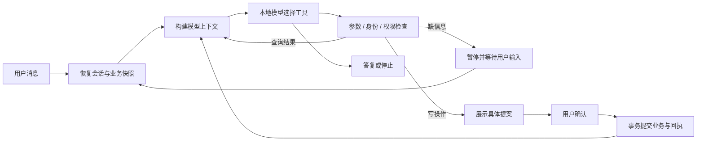

# RetailFlow

本地零售业务 Agent，基于 LangGraph、Ollama 和固定版 τ2-bench retail 模拟环境，支持订单查询、取消与退货。

[业务演示](#业务演示) · [主要改造](#主要改造) · [执行流程](#执行流程) · [快速开始](#快速开始) · [设计说明](docs/architecture.md)

项目把模型决策和业务提交分开：模型选择工具、提出操作；应用检查身份和权限，展示具体提案，收到用户确认后才修改订单。SQLite 保存业务快照与执行回执，用于进程恢复和重复执行保护。

这是运行在 Apple M5 / 16 GB Mac 上的实验原型。订单、用户和支付记录均为模拟数据，不连接真实电商或支付系统。

## 业务演示

取消一笔待处理订单，沿同一条链路观察查询、提案、确认与提交：

```bash
DEMO_THREAD="cancel-$(date +%Y%m%d-%H%M%S)"
.venv/bin/python -m retailflow.cli chat \
  --thread "$DEMO_THREAD" --config configs/local.json \
  --message 'I am Yara Muller, ZIP 85041. Please cancel order #W5056519 because I ordered it by mistake.'
```

写工具第一次请求只生成提案。CLI 展示订单和原因，等待用户输入 `yes` 或 `no`；模型本身没有确认权限。确认时必须对应当前提案和原参数。

可以在等待确认时退出进程，再用同一个 thread 恢复：

```bash
.venv/bin/python -m retailflow.cli chat \
  --thread "$DEMO_THREAD" --config configs/local.json
```

恢复已有会话时不传新 `--message`。同一个 thread 使用自己的业务副本；新的独立演示使用新 thread。

另一个关键案例是参数变化：只修改取消原因，旧确认应失效，新提案必须重新确认。仓库提供不调用模型的业务保护层示例：

```bash
.venv/bin/python examples/confirmation_change.py
```

[完整演示与结果检查](docs/demos.md)。实际模型可能选错工具或提前结束，业务是否完成要看工具结果与最终状态，不能只看回复文字。

## 主要改造

复用 [react-agent](https://github.com/langchain-ai/react-agent) 的模型—工具循环模板，以及 [τ2-bench](https://github.com/sierra-research/tau2-bench) 的 retail 数据、政策和业务方法。新增实现集中在执行约束与会话管理：

| 设计 | 解决的问题 | 代码入口 |
| --- | --- | --- |
| 显式操作提案 | 防止模型替用户确认，或沿用已经变更的订单、商品与原因 | [environment.py](src/retailflow/environment.py) |
| 业务状态与回执同事务提交 | 已写入后进程退出，恢复时不重复提交同一操作 | [storage.py](src/retailflow/storage.py) |
| 完整历史与模型上下文分开 | 保留用户要求、必要状态与完整工具消息块，同时控制输入预算 | [context.py](src/retailflow/context.py) |
| 交互和批量运行共用入口 | 避免演示与业务任务执行两套逻辑 | [runtime.py](src/retailflow/runtime.py) |
| 原生工具协议处理 | 缺信息时暂停交互；普通文本不冒充工具调用或执行结果 | [运行时](src/retailflow/runtime.py)、[图节点](src/react_agent/graph.py) |

## 执行流程



模型可见八个业务工具及一个 `ask_user`。`confirm_action` 不向模型暴露；写入结果未知时不自动重试写操作。恢复与重复执行保护仅针对本地事务和已测试路径，不是分布式 exactly-once 保证。

## 快速开始

参考环境：Python 3.12.15、uv、Ollama 0.15.6，模型为 `qwen3:4b-instruct-2507-q4_K_M`。仓库锁定依赖，不要求云 API Key、Docker 或 PyTorch。

```bash
git clone https://github.com/snowstorm-121/RetailFlow.git
cd RetailFlow
uv sync --locked --python 3.12
ollama list
curl -sS http://127.0.0.1:11434/api/version
.venv/bin/python -m retailflow.cli validate --manifest data/manifests/dataset.json
```

`uv sync` 可能联网下载解释器和依赖；Ollama 服务和完整模型标签需另行准备，项目不会自动下载模型。环境就绪后运行上面的业务演示。工具定义和模拟业务为英文，演示也使用英文。

## 设计与源码

- [执行架构与设计取舍](docs/architecture.md)：原生调用、提案、事务、恢复与上下文。
- [演示操作指南](docs/demos.md)：取消、参数变更、政策拒绝，以及常见故障。
- [来源与二次开发](reports/contribution.md)：框架、业务方法与新增模块的范围。
- [固定上游清单](UPSTREAM.md)：版本、适配文件与许可信息。

`src/react_agent/` 是模板改造层，`src/retailflow/` 是业务执行与会话层；`tests/` 包含确定性回归。`runtime/`、`artifacts/`、模型和虚拟环境不提交 Git。历史实验记录保留在 `reports/`，与本文的演示说明分别维护。

## 已知限制

当前入口是 CLI，没有网页或真实平台接入。小模型仍可能错误追问、遗漏用户要求或生成没有工具依据的完成声明。应用保护能限制部分副作用，不能代替正确的规划和业务沟通。

上下文 token 预算采用字符估算；身份检查遵循模拟环境政策，不是生产账户认证。项目没有生产可用性或全面安全承诺。

上游许可证保留在 [LICENSES/](LICENSES/) 和 [τ2-bench 来源目录](vendor/tau_retail/source/LICENSE)。新增代码尚未选择独立许可证；开发与辅助审查说明见[来源文档](reports/contribution.md)。
