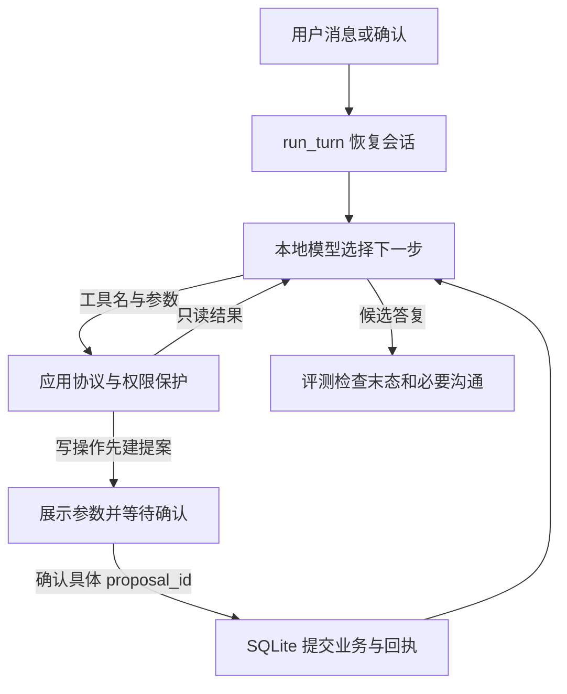

# RetailFlow 面试与基础讲解

沿一次取消订单理解工具循环、权限、确认、回执和评分。本文提供技术介绍、源码阅读路线和自查问题；当前正式结果为 Dev 三组各 0/9、Test 三组各 0/4。

## 先记四个边界

- 9 个模型可见工具：8 个业务工具加 ask_user。不是 9 个 Agent。
- 13 道派生任务：Dev 9/Test 4；80 是未达成目标。
- 104 个确定性工程测试通过，与业务任务成功率不是同一个分母。
- 正式 Dev/Test 三组均零成功，没有可宣称的提升。

## 从一次实际取消开始

Agent 在这里指一个循环：模型依据当前消息决定“回答还是请求工具”；应用执行允许的工具，把结果交回模型，直到回答、需要用户信息、需要确认、错误或预算结束。ReAct 表示推理与行动交替的组织方式，本项目不宣称展示或验证模型内部完整思维链。Function Calling 是模型返回结构化工具名/参数；应用才是真正执行 Python 方法的一方。

用户说“取消 #W5056519，Yara Muller，ZIP 85041，误下单”。输入从 [cli.py](../src/retailflow/cli.py) 的 `chat` 进入 [runtime.py](../src/retailflow/runtime.py) 的 `run_turn`，恢复 thread 的 SQLite 状态。[graph.py](../src/react_agent/graph.py) 的 `make_retail_graph` 调用本地模型并绑定工具。

模型先定位用户、查询订单。结果作为 ToolMessage 回到循环。取消工具第一次返回 CONFIRMATION_REQUIRED，只在业务副本上预检政策并保存提案；应用展示具体参数，模型拿不到 `confirm_action` 工具。用户确认事件绑定 proposal_id 后，应用才提交业务变化与回执，再由模型解释结果。T8 真实演示中订单 cancelled、支付记录 1→2，见 [操作单](demos.md)。

模型不直接拿整份订单 DB，不因为输出“取消成功”就改变业务。图结构不等于预写业务链，具体选哪项工具仍由模型决定。没有工具请求时就可能提前回答，这是当前主要失败边界。

## 五分钟沿代码追问

| 时间 | 面试问题 | 应解释的代码与事实 |
| --- | --- | --- |
| 第 1 分钟 | 改了上游什么？ | react-agent 的 StateGraph 循环做本地接入；τ2 retail 方法和数据固定复用；新增权限、提案、回执、上下文、评测。不是自研模型或业务政策。见 [贡献表](../reports/contribution.md)。 |
| 第 2 分钟 | 为什么模型不能替用户确认？ | [environment.py](../src/retailflow/environment.py) 的 `dispatch_tool / confirm_action`：确认不在模型工具表，绑定当前提案和完全相同参数。输入 reason 改变使旧 ID 失效；不是在 prompt 里写“请安全”就结束。 |
| 第 3 分钟 | 写入成功后进程崩了怎么办？ | [storage.py](../src/retailflow/storage.py) 同事务提交业务 JSON 与 receipt；runtime 恢复先查已提交回执。重试一次模型答复不等于再次退款。没有跨分布式系统 exactly-once 承诺。 |
| 第 4 分钟 | 为什么要裁剪上下文？ | [context.py](../src/retailflow/context.py) 的 `build_model_context`：完整历史落盘，模型只接收受控视图；最新意图与最新完整工具块优先，调用/结果不能拆开。字符估算不是 tokenizer 精确计数。 |
| 第 5 分钟 | 104 测试通过，为什么 Test 0/4？ | [evaluation.py](../src/retailflow/evaluation.py) 的 `score_episode / apply_review / aggregate_results`：工程路径测试与真实模型任务不同。模型没有正确追问信息或违反工具协议，保护层拒绝也没完成用户目标。 |

SQLite 持久化由项目自定义表保存业务、消息和预算，不是已经接入 LangGraph 原生 SqliteSaver。checkpoint/持久化不等于跨会话长期记忆。读故障重试只针对明确执行前失败，至多一次；政策拒绝和写动作不走盲重试。重试会增加 dispatcher 尝试成本，未必使整题成功。本轮 Test 没有故障任务，恢复率 0/0 未定义。

## 两分钟介绍稿

> RetailFlow 是一个本地零售业务执行 Agent 原型，目标是把“模型提出操作”和“应用真正改变订单”分开，并让过程可复查。我在 LangChain 的 react-agent 模板和固定版 τ2 retail 模拟环境上推进二次开发，使用已有 Ollama Qwen3 4B 量化模型，没有训练模型，也没有接真实电商。
>
> 项目提供订单查询、取消和退货等有限工具。写操作先生成绑定参数的提案，用户确认后才提交。SQLite 同时保存业务结果和回执，避免恢复时重复写；上下文保留关键状态和完整工具消息块，只对明确执行前的只读故障有限重试。CLI 与评测使用同一条运行链路。
>
> 已有真实模型确认取消和政策拒绝演示，工程测试 104 个通过。不过正式评测只有 Dev 9 道、Test 4 道，三组都没有端到端成功。模型缺信息时常用普通文字追问而不调用交互工具，还会编造示例身份或违反调用协议。保护层拦住了部分错误，但没有完成业务目标。因此我把它定位为可审计的本地原型和失败复盘项目，不声称高成功率、官方榜单成绩或生产可用。下一步改进必须另建实验版本，不能把已看过的 Test 继续当未见测试集。

介绍时应将机制、代码和实际证据对应起来；单例演示、确定性测试与正式模型评测分别报告。

## 真实问题如何讲

挑一个自己能沿轨迹说清的例子，不背一组虚构难点。推荐顺序：

1. T8 提案参数改变：只改 reason，旧 ID 确认失败，新提案重新确认；状态与支付检查证明未沿用旧授权。
2. 快照污染：Pydantic 补默认字段，整份 model_dump 写回会改变无关订单形状；改为把执行前后实际差异合并原始 JSON，严格评分仍保留。没有修改上游业务政策。
3. T7 查询失败：两个参数格式合法的工具请求却编造身份且混合说明文本，被协议拒绝；最后只追问身份，没给 $829.43。不是服务连不上，也不是“Function Calling 完全不支持”。

每个例子按“触发输入 → 首个错误证据 → 原因与推断的界限 → 改动或保持开放 → 如何验证”讲。详见 [问题记录](../reports/problems.md)。当前未解决的模型选择问题必须说未解决。

## 自查问题

可按以下顺序检查自己能否沿代码解释输入、执行和输出：

1. 从项目目录怎样用正确解释器启动 CLI？看到 AUTH_REQUIRED 后先检查哪条工具请求？
2. 取消提案已确认但未执行，只改 reason，为什么仍需新 proposal_id？
3. 订单已提交，模型回复却超时，为什么不能重新退款？
4. schema 合法 3/3、拦截 3 次、业务成功 0/4，三个数字为什么能同时成立？

关键接口、任务状态与实际调用轨迹应一起阅读；不要仅凭自然语言答复判断业务成功。
